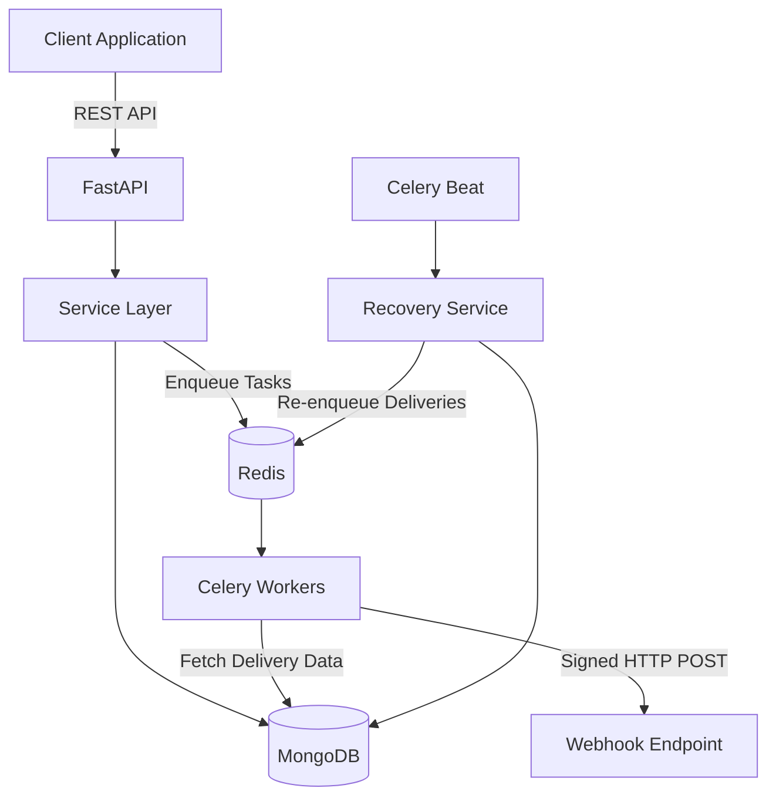

# HookFlow – Reliable Webhook Delivery Platform

HookFlow is a backend platform for reliable asynchronous webhook delivery. It allows client applications to register webhook endpoints, subscribe to events, publish events, and track delivery outcomes.

Built using **Python, FastAPI, MongoDB, Redis, and Celery**, the platform focuses on reliable message processing, failure recovery, concurrency control, and secure webhook communication.

## Key Features

- **Client Management & Authentication:** Client registration and API key-based authentication, with only hashed API keys stored.
- **Webhook Management:** Register endpoints and manage event subscriptions.
- **Event Ingestion:** Persist events and create individual delivery records for subscribed endpoints.
- **Asynchronous Delivery:** Process webhook requests using Celery workers and Redis.
- **Retry Mechanism:** Automatically retry transient failures with configurable backoff delays and a maximum of five attempts.
- **Delivery Recovery:** Periodically recover pending deliveries and deliveries with expired processing leases using Celery Beat.
- **Concurrency Control:** Atomic MongoDB operations and processing leases prevent concurrent workers from claiming the same active delivery.
- **HMAC Request Signing:** Sign outgoing requests using HMAC-SHA256 for authenticity and integrity verification.
- **Delivery Tracking:** Track delivery status, attempts, HTTP responses, and retry information.

## Technology Stack

| Component | Technology |
|---|---|
| Language | Python 3.12 |
| API Framework | FastAPI |
| Database | MongoDB |
| Message Broker | Redis |
| Task Processing | Celery |
| Data Validation | Pydantic |
| HTTP Client | HTTPX |
| Authentication | API Keys |
| Request Signing | HMAC-SHA256 |

## Architecture



The application follows a modular architecture with separate routers, services, repositories, schemas, and background task modules.

## Reliability Design

**Retry Handling**

Delivery outcomes are classified based on HTTP responses:

- 2xx: Marked as delivered.
- 4xx (except 408 and 429): Marked as failed.
- 408, 429, and 5xx: Retried.
- Network errors and timeouts: Retried.

Maximum attempts: **5**

| Attempt | Retry Delay |
|---|---|
| 1 | 5 seconds |
| 2 | 15 seconds |
| 3 | 45 seconds |
| 4 | 120 seconds |
| 5 | No further retry |

**Atomic Delivery Claiming**

MongoDB's atomic `find_one_and_update()` operation ensures that only one worker can claim an eligible delivery at a time. Processing leases allow abandoned deliveries to become eligible for recovery after worker failures.

**Automatic Recovery**

Celery Beat periodically scans for due pending deliveries, due retries, and deliveries with expired processing leases, then re-enqueues them.

**Delivery Guarantee**

HookFlow follows an **at-least-once delivery model**. Receiving applications should implement idempotent event handling to account for potential duplicate requests.

## HMAC Request Signing

Outgoing webhook requests are signed using HMAC-SHA256 with a unique signing secret for each endpoint.

The signature is generated using the timestamp and exact serialized request body:

```text
message = timestamp + "." + request_body
signature = HMAC-SHA256(signing_secret, message)
```

Requests include:

- `X-HookFlow-Timestamp`
- `X-HookFlow-Signature`

Receiving applications can independently calculate and verify the signature using constant-time comparison.

## Project Structure

```text
webhook-platform/
├── dependencies/
├── exceptions/
├── mock_receiver/
├── repositories/
├── routers/
├── schemas/
├── services/
├── tasks/
├── tests/
├── utils/
├── celery_app.py
├── database.py
├── main.py
├── requirements.txt
└── README.md
```

## Getting Started

### Prerequisites

- Python 3.12+
- MongoDB Community Server
- Docker Desktop
- Redis 7

### 1. Clone the repository

```bash
git clone https://github.com/yugam-tyagi/HookFlow.git
cd HookFlow
```

### 2. Create a virtual environment

**Windows PowerShell:**

```powershell
python -m venv venv
.\venv\Scripts\Activate.ps1
```

**Linux / macOS:**

```bash
python3 -m venv venv
source venv/bin/activate
```

### 3. Install dependencies

```bash
pip install -r requirements.txt
```

### 4. Start Redis

```bash
docker run -d --name hookflow-redis -p 6379:6379 redis:7-alpine
```

### 5. Start the FastAPI application

```bash
uvicorn main:app --reload
```

### 6. Start the Celery worker

In a separate terminal:

```bash
celery -A celery_app worker --loglevel=info --pool=solo
```

### 7. Start Celery Beat

In another terminal:

```bash
celery -A celery_app beat --loglevel=info
```

### 8. Explore the API

Open the interactive Swagger documentation:

[http://127.0.0.1:8000/docs](http://127.0.0.1:8000/docs)

MongoDB should be running locally with the application's configured connection string.

## Testing

The project includes tests and integration scenarios covering:

- Successful webhook delivery and permanent failures.
- Retry scheduling and retry exhaustion.
- Recovery of pending deliveries.
- Concurrent delivery claiming.
- HMAC signature verification.
- Delivery tracking and client-level access isolation.

Run the test suite using:

```bash
pytest
```

---

**HookFlow** — Exploring reliable asynchronous processing, distributed systems concepts, concurrency control, and secure webhook delivery.


## Documentation

- [System Architecture](docs/architecture.md)