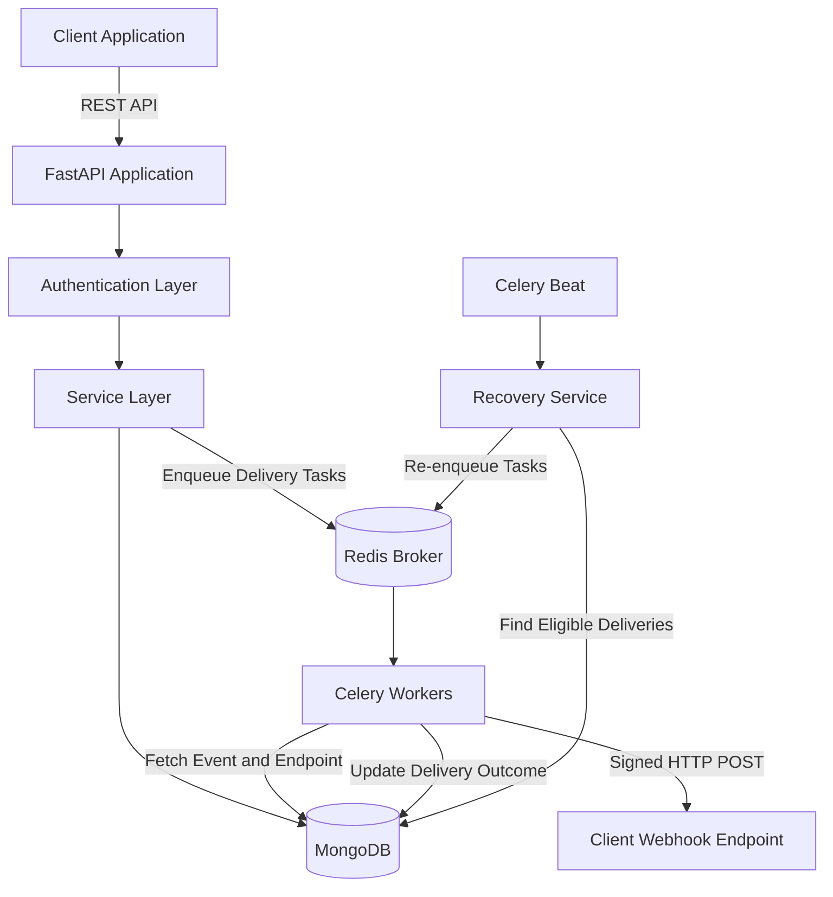
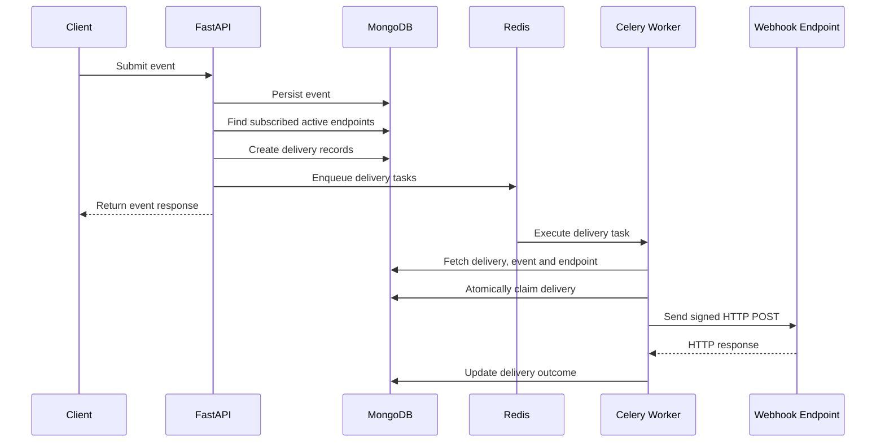
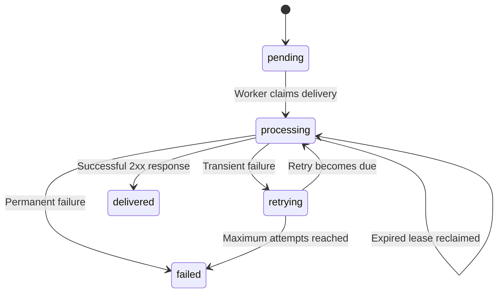
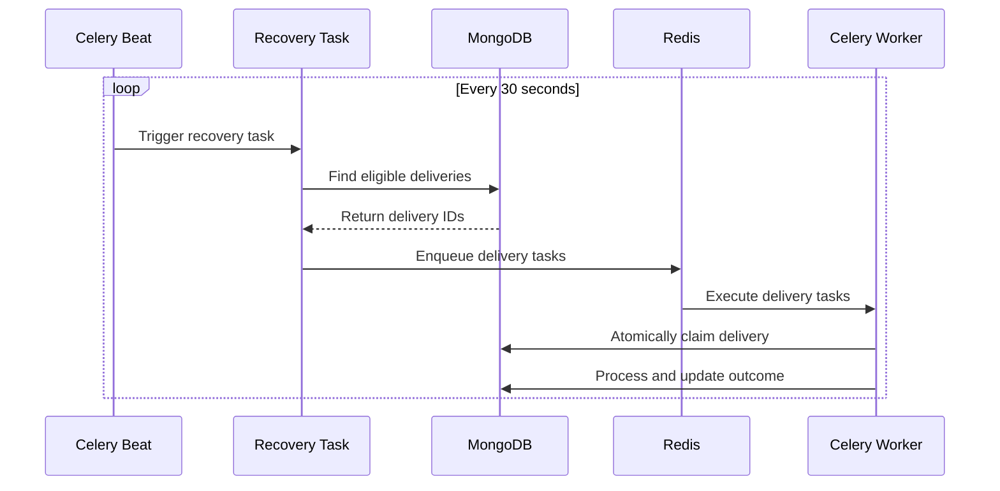

# HookFlow – System Architecture

## 1. Overview

HookFlow is a reliable asynchronous webhook delivery platform built using FastAPI, MongoDB, Redis, and Celery.

The platform enables client applications to register webhook endpoints, subscribe to event types, publish events, and track delivery outcomes.

The architecture separates event ingestion from webhook delivery, ensuring that incoming API requests do not need to wait for downstream webhook endpoints to respond.

The primary design goals are:

- Asynchronous event processing.
- Reliable delivery with retry handling.
- Recovery from worker failures and lost tasks.
- Protection against concurrent processing of the same delivery.
- Secure webhook communication using HMAC signatures.
- Persistent delivery tracking.

## 2. High-Level Architecture



### Technology Responsibilities

| Component | Responsibility |
|---|---|
| FastAPI | Exposes REST APIs and handles incoming requests |
| MongoDB | Persistent storage for clients, API keys, endpoints, events, and deliveries |
| Redis | Message broker for asynchronous task execution |
| Celery Workers | Execute webhook delivery tasks |
| Celery Beat | Periodically triggers delivery recovery |
| HTTPX | Sends HTTP requests to registered webhook endpoints |

MongoDB acts as the source of truth for delivery state, while Redis facilitates asynchronous task execution.

## 3. Application Architecture

HookFlow follows a modular layered architecture.

### Routers

Expose REST API endpoints and handle request routing, authentication dependencies, and response models.

### Dependencies

Handle shared request dependencies, including API key authentication.

### Services

Contain business logic and coordinate operations across repositories and background tasks.

### Repositories

Encapsulate MongoDB operations, including document creation, retrieval, updates, atomic claims, and recovery queries.

### Schemas

Define request validation and response structures using Pydantic.

### Tasks

Contain Celery background tasks responsible for webhook delivery and periodic recovery.

### Mock Receiver

Provides HTTP endpoints for integration testing of successful deliveries, failures, timeouts, and signature verification.

## 4. Event Ingestion and Delivery Flow

When a client submits an event, HookFlow performs the following operations:



### Step-by-step processing

1. A client authenticates using its API key and submits an event.
2. The event is persisted in MongoDB.
3. HookFlow identifies active webhook endpoints subscribed to the event type.
4. A separate delivery document is created for every matching endpoint.
5. Delivery tasks are enqueued for asynchronous processing.
6. Celery workers process the delivery tasks independently.
7. Each worker retrieves the associated event and endpoint details.
8. The worker claims the delivery before sending the HTTP request.
9. The worker sends the event payload with the required HMAC headers.
10. The response and delivery outcome are persisted in MongoDB.

This design allows the event ingestion API to remain independent of downstream endpoint response times.

## 5. Delivery State Management

Each delivery is tracked independently using a MongoDB document.

### Delivery Document

The delivery record contains fields such as:

| Field | Description |
|---|---|
| `event_id` | Associated event identifier |
| `client_id` | Owning client identifier |
| `endpoint_id` | Destination webhook endpoint |
| `status` | Current delivery state |
| `attempt_count` | Number of HTTP delivery attempts |
| `next_attempt_at` | Scheduled retry or processing time |
| `http_status` | HTTP response status |
| `response_body` | Receiver response body |
| `error_message` | Transport or delivery error details |
| `processing_started_at` | Time at which processing was claimed |
| `lease_expires_at` | Expiration time of the processing lease |
| `completed_at` | Time at which delivery reached a terminal state |

### Delivery State Transitions



The primary delivery states are:

- `pending`: Delivery has been created and is awaiting processing.
- `processing`: A worker has successfully claimed the delivery.
- `retrying`: A transient failure occurred and another attempt is scheduled.
- `delivered`: The receiver returned a successful 2xx response.
- `failed`: The delivery encountered a permanent failure or exhausted its retry attempts.

`delivered` and `failed` are terminal states in the normal delivery lifecycle.

## 6. Retry Mechanism

HookFlow classifies HTTP responses and transport errors to determine whether a delivery should be retried.

### Failure Classification

| Response | Action |
|---|---|
| 2xx | Mark as delivered |
| 4xx except 408 and 429 | Permanent failure |
| 408 Request Timeout | Retry |
| 429 Too Many Requests | Retry |
| 5xx | Retry |
| Network errors / timeouts | Retry |

### Retry Policy

The maximum number of HTTP delivery attempts is five.

| Attempt | Delay Before Next Attempt |
|---|---|
| 1 | 5 seconds |
| 2 | 15 seconds |
| 3 | 45 seconds |
| 4 | 120 seconds |
| 5 | No further retry |

After a retryable failure:

1. The attempt count and HTTP response details are updated.
2. The delivery status changes to `retrying`.
3. The next retry timestamp is calculated.
4. The processing lease is cleared.
5. The delivery becomes eligible for processing when its retry time arrives.

Once the maximum attempt count is reached, the delivery is marked as `failed`.

## 7. Atomic Delivery Claiming and Processing Leases

### Problem

Multiple Celery tasks may reference the same delivery. This can happen because of duplicate task enqueueing, task redelivery, or recovery processing.

Without concurrency protection, multiple workers could send the same webhook simultaneously.

### Solution: Atomic MongoDB Claim

HookFlow uses MongoDB's atomic `find_one_and_update()` operation to claim an eligible delivery.

The claim operation checks whether the delivery is:

- Pending and due for processing.
- Retrying and due for another attempt.
- Processing with an expired lease.

If the conditions are satisfied, the operation atomically:

- Changes the status to `processing`.
- Records `processing_started_at`.
- Assigns a `lease_expires_at` timestamp.

Only one competing worker can successfully claim the same eligible delivery.

### Processing Leases

A processing lease prevents a delivery from remaining permanently stuck in the `processing` state if a worker crashes or becomes unavailable.

When a lease expires, the recovery mechanism can make the delivery eligible for another processing attempt.

This provides a recovery mechanism without relying on workers to complete every task successfully.

## 8. Automatic Delivery Recovery

### Why Recovery Is Required

Persisting delivery records and enqueueing Celery tasks are separate operations.

A failure between these operations can leave a delivery persisted in MongoDB but absent from the Redis task queue.

Similarly, a worker may terminate unexpectedly while processing a delivery.

To address these scenarios, HookFlow implements a periodic recovery mechanism using Celery Beat.

### Recovery Workflow



### Recovery Criteria

The recovery service identifies:

1. Pending deliveries whose `next_attempt_at` timestamp has arrived.
2. Retrying deliveries whose `next_attempt_at` timestamp has arrived.
3. Processing deliveries whose `lease_expires_at` timestamp has expired.

Eligible delivery IDs are re-enqueued for processing.

The recovery scan is bounded to a maximum of 100 records per execution.

### Why Both Redis and MongoDB Are Used

Redis is responsible for task distribution, not durable delivery-state ownership.

MongoDB stores the authoritative delivery state and scheduling information.

This separation allows HookFlow to recover eligible deliveries even when the corresponding Celery task was not successfully processed.

## 9. HMAC Request Signing

HookFlow uses HMAC-SHA256 to sign outgoing webhook requests.

Each webhook endpoint receives a unique signing secret during initial registration.

### Signature Generation

The signature is calculated using the timestamp and exact serialized request body:

```text
message = timestamp + "." + request_body

signature = HMAC-SHA256(signing_secret, message)
```

The request includes two custom headers:

| Header | Purpose |
|---|---|
| `X-HookFlow-Timestamp` | Identifies the delivery attempt timestamp |
| `X-HookFlow-Signature` | Contains the HMAC-SHA256 signature |

### Receiver-side Verification

The receiving application:

1. Reads the raw HTTP request body.
2. Extracts the timestamp and signature headers.
3. Reconstructs the signed message.
4. Calculates the expected HMAC using its endpoint signing secret.
5. Compares the expected and received signatures using constant-time comparison.

A fresh timestamp and signature are generated for every delivery attempt.

### Security Considerations

HMAC provides authenticity and integrity verification, but it does not encrypt request contents. HTTPS is required for encryption in transit.

Timestamp freshness validation and event ID deduplication are responsibilities of the receiving application. The receiver should reject stale requests and prevent duplicate event processing.

## 10. Delivery Semantics and Failure Scenarios

HookFlow follows an **at-least-once delivery model**.

A duplicate delivery is possible in certain failure scenarios.

For example:

1. A worker successfully sends an HTTP request.
2. The receiving application processes the request.
3. The worker crashes before updating the delivery status in MongoDB.
4. The processing lease expires.
5. The recovery service re-enqueues the delivery.
6. Another worker sends the request again.

HookFlow cannot guarantee exactly-once processing across an external HTTP endpoint and its own database.

Therefore, receiving applications should implement idempotency using event identifiers to handle duplicate requests safely.

### Reliability Mechanisms

| Failure Scenario | Mechanism |
|---|---|
| Receiver returns HTTP 5xx | Retry policy |
| Receiver times out | Retry policy |
| Worker crashes during processing | Processing lease |
| Duplicate task enqueueing | Atomic delivery claim |
| Delivery task not successfully enqueued | Periodic recovery |
| Maximum retries exhausted | Terminal failed state |

## 11. Design Decisions

### Why asynchronous delivery?

Webhook endpoints are external dependencies and may respond slowly or become unavailable.

Asynchronous processing prevents downstream endpoint latency from directly affecting event ingestion.

### Why MongoDB?

MongoDB provides flexible document storage for event payloads and delivery metadata, along with atomic document updates for concurrency control.

### Why Redis and Celery?

Redis provides a lightweight message broker, while Celery manages background task execution and periodic scheduling through Celery Beat.

### Why at-least-once delivery?

Prioritizing recoverability and eventual delivery is more practical than claiming exactly-once processing across independent systems and external HTTP endpoints.

### Why atomic claims and leases?

They protect against concurrent task execution and allow abandoned processing work to become eligible for recovery.

---

**HookFlow explores the engineering challenges of reliable asynchronous processing, distributed task execution, concurrency control, failure recovery, and secure webhook delivery.**